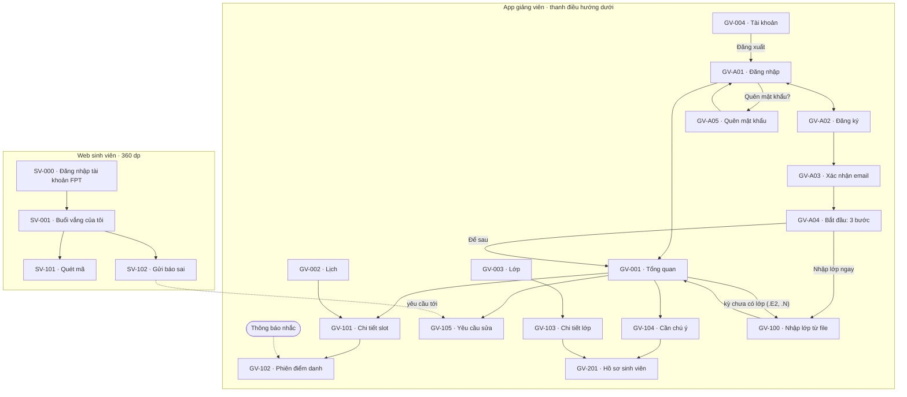
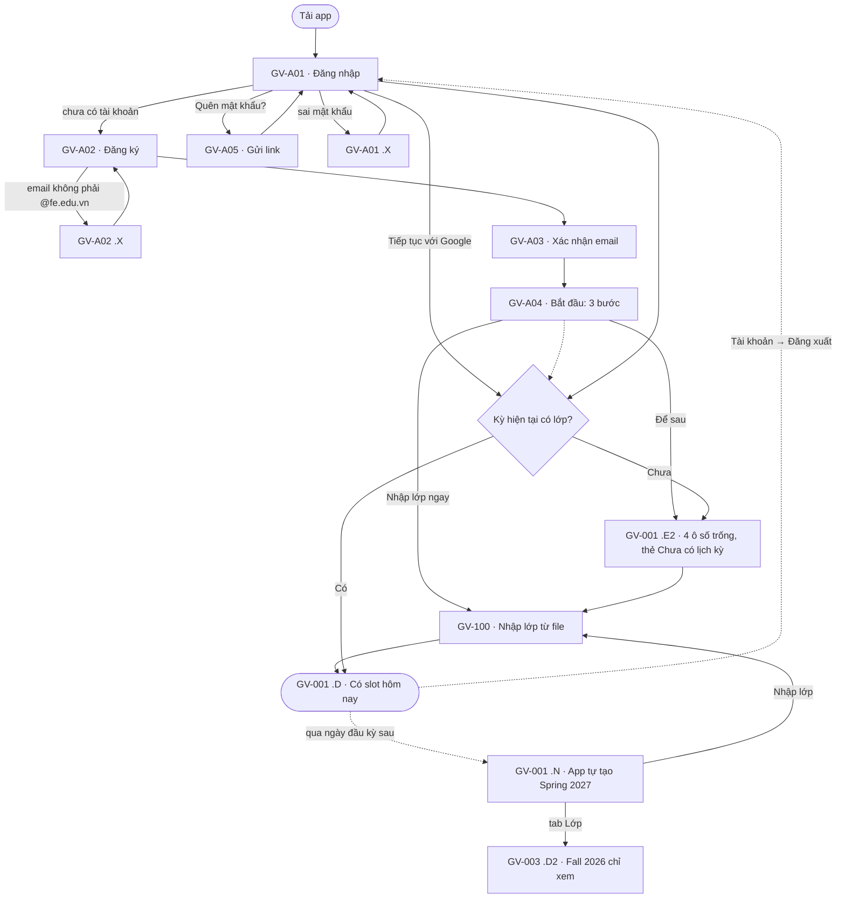
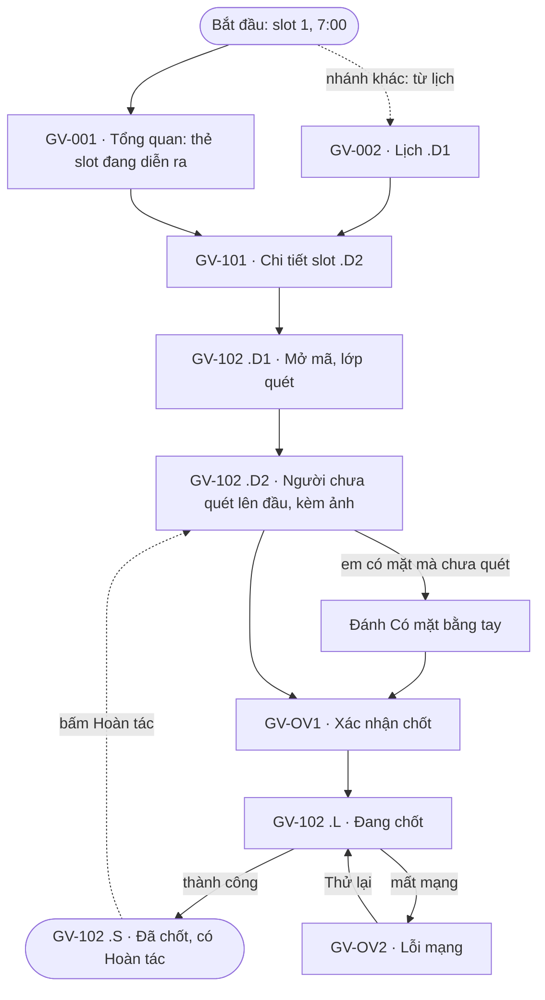
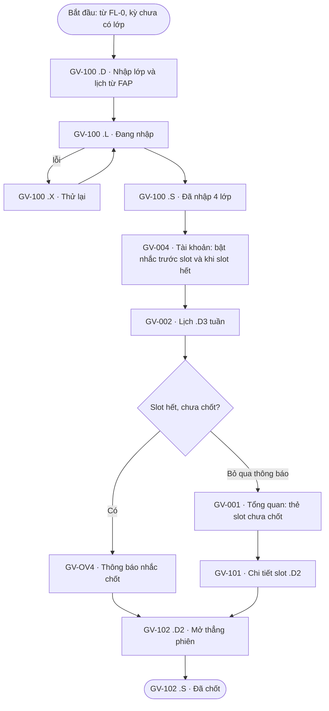
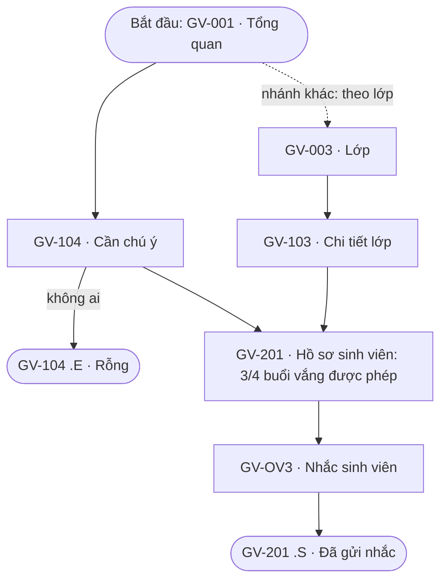
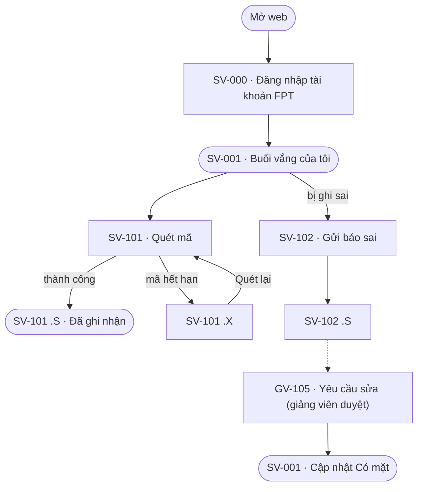

# Kiến trúc thông tin và user flow

> **Trạng thái:** v0.4 (29/10 tối): đăng nhập Google, bước đệm GV-A04 sau đăng ký, quên mật khẩu GV-A05, Tổng quan kỳ chưa có lớp giữ 4 ô số trống + thẻ “Chưa có lịch kỳ …” (D-20..D-23). v0.3 (29/10/2026): thêm vòng đời đầy đủ (đăng ký, đăng nhập, chưa có lớp, sang kỳ mới, đăng nhập web sinh viên), FL-0 và FL-0b (D-16..D-18). v0.2 (20/10/2026). “Setup” là bước nhập lớp và lịch từ FAP lúc dùng lần đầu (thien chốt 20/10, E-12). Mọi tính năng truy về E-xx trong [ma trận bằng chứng](../research/02-evidence-matrix.md).

## 1. Hệ mã màn hình

```
<Kênh>-<Cấp><Số> · <Tên> .<Trạng thái>
Kênh:       GV = app giảng viên   SV = web sinh viên
Cấp:        A = trước khi vào app (đăng nhập, đăng ký)   0 = tab gốc   1 = màn con   2 = màn cháu   OV = lớp phủ (dialog, sheet)
Trạng thái: .D mặc định  .L đang tải  .E rỗng  .X lỗi  .S thành công  .N kỳ mới
            Trạng thái nghiệp vụ đánh số: .D1, .D2, ...
```

Tên frame Figma, ảnh trong `assets/figma/` và dòng trong `design/screen-spec.md` dùng cùng một mã. Ví dụ: `GV-102 · Phiên điểm danh .X` là màn phiên điểm danh khi mất mạng.

## 2. Kiến trúc thông tin



## 3. Danh sách màn hình

14 màn khác nhau cho app giảng viên (đề yêu cầu ≥ 8), 4 màn cho web sinh viên.

| Mã | Tên | Cấp | Persona | Flow | Trạng thái | Nguồn |
|---|---|---|---|---|---|---|
| GV-A01 | Đăng nhập | A | P-01, P-02 | FL-0 | .D, .X sai mật khẩu | D-16 |
| GV-A02 | Đăng ký (email @fe.edu.vn, mật khẩu) | A | P-01, P-02 | FL-0 | .D, .X email không phải của trường | D-16 |
| GV-A03 | Xác nhận email (mã 6 số) | A | P-01, P-02 | FL-0 | .D | D-16 |
| GV-A04 | Bắt đầu: 3 bước nhập lớp → lịch tự có → điểm danh | A | P-01, P-02 | FL-0 | .D | D-21 |
| GV-A05 | Quên mật khẩu | A | P-01, P-02 | FL-0 | .D, .S đã gửi link | D-23 |
| GV-001 | Tổng quan | 0 | P-01, P-02 | FL-0, FL-0b, FL-1, FL-3 | .D, .D1 (có slot chưa chốt), .L, .E (hôm nay không dạy), .E2 (kỳ chưa có lớp), .N (kỳ mới), .X | E-01, E-03, E-05, E-09 |
| GV-002 | Lịch | 0 | P-01, P-02 | FL-1, FL-2 | .D1 hôm nay, .D2 ngày mai, .D3 tuần, .E | E-03 |
| GV-003 | Lớp | 0 | P-01 | FL-3, FL-0b | .D, .D2 (kỳ cũ, chỉ xem), .E | E-03 |
| GV-004 | Tài khoản | 0 | P-02 | FL-2 | .D | E-01 (cài nhắc) |
| GV-100 | Thiết lập lần đầu: nhập lớp, lịch từ FAP | 1 | P-02 | FL-2 | .D chọn lớp, .L đang nhập, .X nhập lỗi, .S xong | E-12 |
| GV-101 | Chi tiết slot | 1 | P-01, P-02 | FL-1, FL-2 | .D1 sắp tới, .D2 đang diễn ra, .D3 đã chốt | E-03 |
| GV-102 | Phiên điểm danh | 1 | P-01, P-02 | FL-1, FL-2 | .D1 mã đang mở, .D2 xem ngoại lệ, .L đang chốt, .X mất mạng, .S đã chốt | E-01, E-04, E-06 |
| GV-103 | Chi tiết lớp | 1 | P-01 | FL-3 | .D | E-03, E-05 |
| GV-104 | Cần chú ý | 1 | P-01 | FL-3 | .D, .E (không ai cần chú ý) | E-05, E-22 |
| GV-105 | Yêu cầu sửa | 1 | P-01 | FL-4 | .D, .E | E-06, E-20 |
| GV-201 | Hồ sơ sinh viên | 2 | P-01 | FL-3 | .D, .S (đã gửi nhắc) | E-05 |
| GV-OV1 | Hộp thoại xác nhận chốt | OV | P-01 | FL-1 | Xác nhận | E-06 |
| GV-OV2 | Hộp thoại lỗi mạng | OV | P-01 | FL-1 | Lỗi (biến thể destructive/error) | — |
| GV-OV3 | Sheet nhắc sinh viên | OV | P-01 | FL-3 | .D | E-05 |
| GV-OV4 | Thông báo nhắc chốt (màn khoá) | OV | P-02 | FL-2 | .D | E-01, E-09, E-10 |
| SV-000 | Đăng nhập tài khoản FPT | A | P-03 | FL-4 | .D | D-17 |
| SV-001 | Buổi vắng của tôi | 0 | P-03 | FL-4 | .D, .D1 sắp chạm ngưỡng, .D2 đã chạm ngưỡng | E-21, E-22 |
| SV-101 | Quét mã | 1 | P-03 | FL-4 | .D camera, .S đã ghi nhận, .X mã hết hạn | E-20 |
| SV-102 | Gửi báo sai | 1 | P-03 | FL-4 | .D, .S đã gửi | E-20 |

**Đã cắt so với v1:** đếm sĩ số, đối chiếu sĩ số, kiểm tra ngẫu nhiên (E-04).

## 4. Flow

### FL-0 · Vòng đời: đăng ký, nhập lớp lần đầu, sang kỳ mới (P-01, P-02)

Bắt đầu: tải app. Mục tiêu: có lớp của kỳ hiện tại để điểm danh. Kết thúc: GV-001 .D có slot. FL-0b là nhánh sang kỳ mới của cùng vòng đời.



**Quy tắc kỳ (D-18):** app đặt tên kỳ theo ngày hiện tại: tháng 1–4 là Spring, 5–8 là Summer, 9–12 là Fall, kèm năm (Spring 2027). Ngày đầu kỳ mới, Tổng quan chuyển sang .N: vẫn đủ bố cục (dòng kỳ ở trái, thứ ngày ở phải; 4 ô số để trống) nhưng phần Chú ý thay bằng thẻ “Chưa có lịch kỳ Spring 2027” và nút Nhập lớp; Lịch (GV-002 .E2) và Lớp cũng dẫn về Nhập lớp. Màn Nhập lớp (GV-100) có app bar và nút quay lại, nên luôn biết mình đến từ đâu. Kỳ cũ giữ ở tab Lớp, chọn bằng chip kỳ, chỉ xem.


### FL-1 · Điểm danh một slot (P-01, K1)

Bắt đầu: slot đang diễn ra. Mục tiêu: chốt điểm danh đúng. Kết thúc: GV-102 .S.



### FL-2 · Không để quên điểm danh (P-02, K2)

Bắt đầu: sau FL-0, cần nhập lớp. Mục tiêu: chốt slot trong ngày dù quên lúc đầu. Kết thúc: GV-102 .S.



### FL-3 · Chăm sóc sinh viên cần chú ý (P-01, K3)

Bắt đầu: Tổng quan. Mục tiêu: nhắc em sắp chạm ngưỡng vắng. Kết thúc: GV-201 .S.



### FL-4 · Sinh viên quét mã và báo sai (P-03, web)

Bắt đầu: SV-001. Mục tiêu: được ghi có mặt. Kết thúc: SV-101 .S hoặc GV-105 đã duyệt.



## 5. Bảng flow ↔ màn

| Flow | Persona | Màn |
|---|---|---|
| FL-0, FL-0b | P-01, P-02 | GV-A01, GV-A02, GV-A03, GV-001 (.E2, .N), GV-100, GV-003 (.D2), GV-004 |
| FL-1 | P-01 | GV-001, GV-002, GV-101, GV-102, GV-OV1, GV-OV2 |
| FL-2 | P-02 | GV-100, GV-004, GV-002, GV-OV4, GV-001, GV-101, GV-102 |
| FL-3 | P-01 | GV-001, GV-104, GV-003, GV-103, GV-201, GV-OV3 |
| FL-4 | P-03, P-01 | SV-000, SV-001, SV-101, SV-102, GV-105 |

Mọi màn đều thuộc ít nhất một flow. FL-1, FL-2 và FL-4 có nhánh lỗi, phục hồi.
