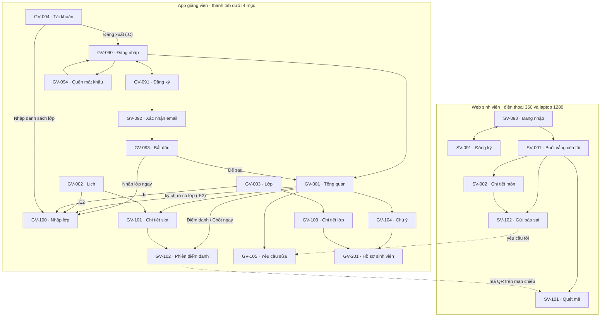
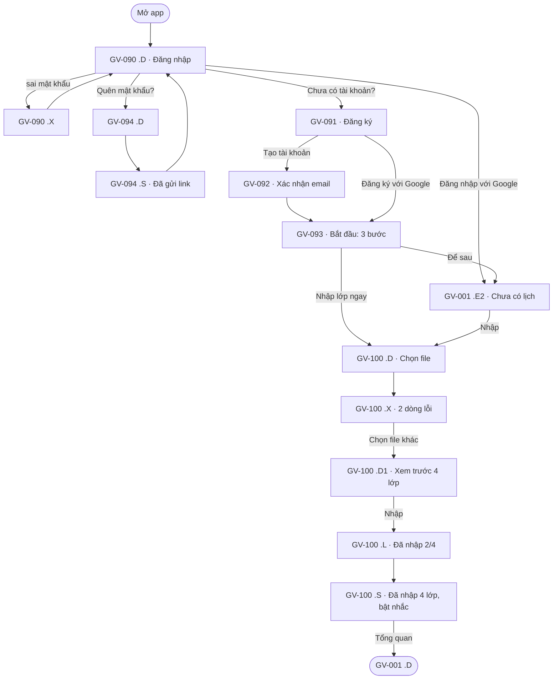
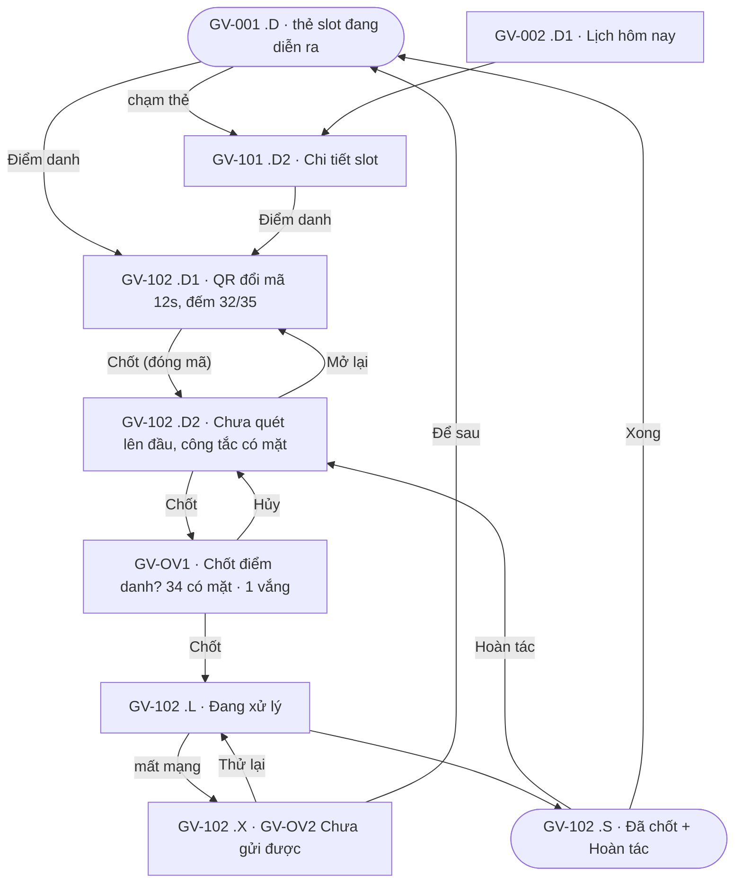
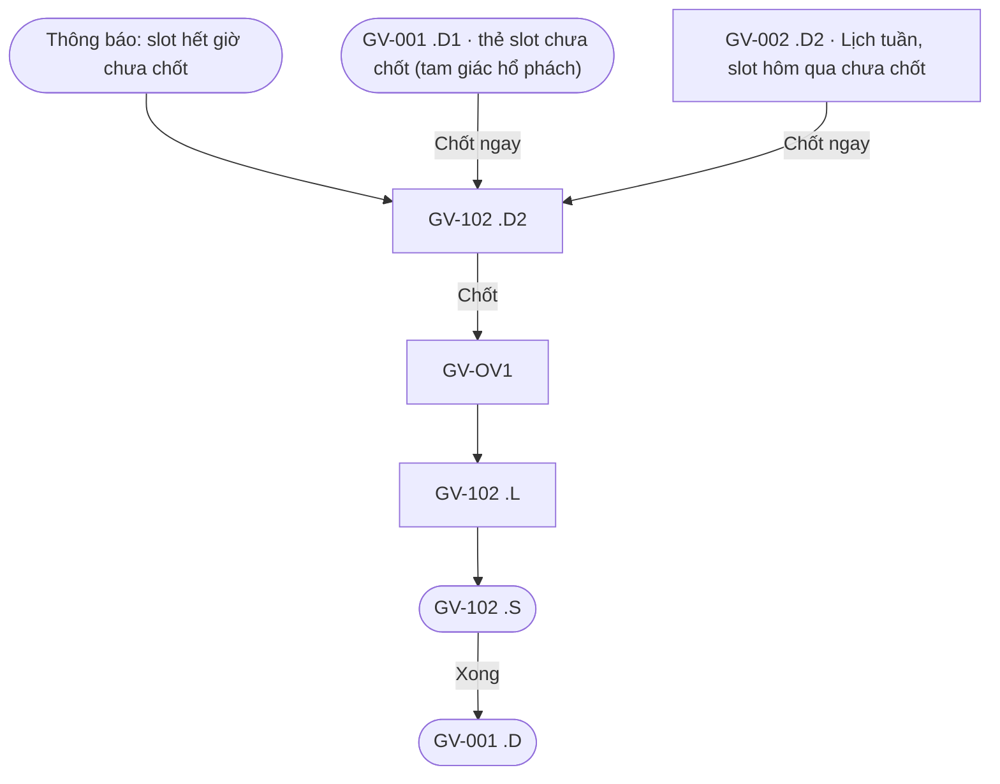
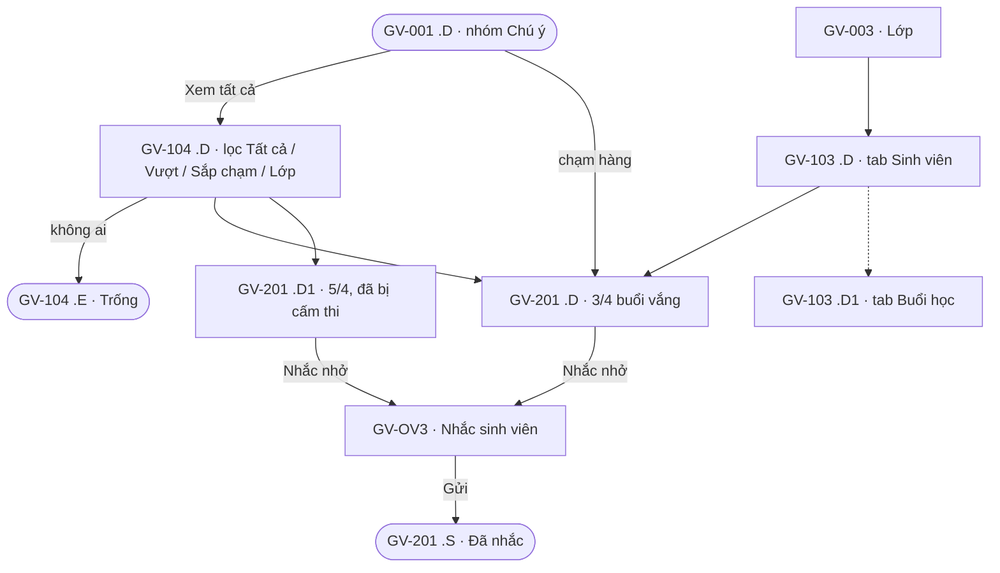
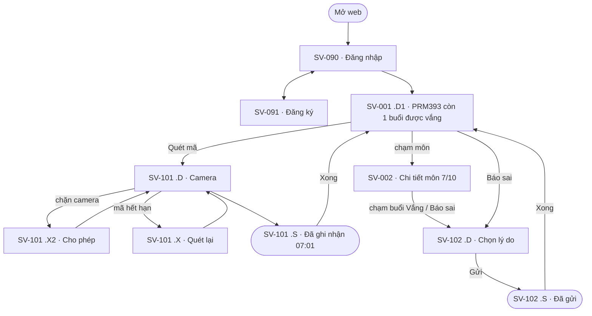
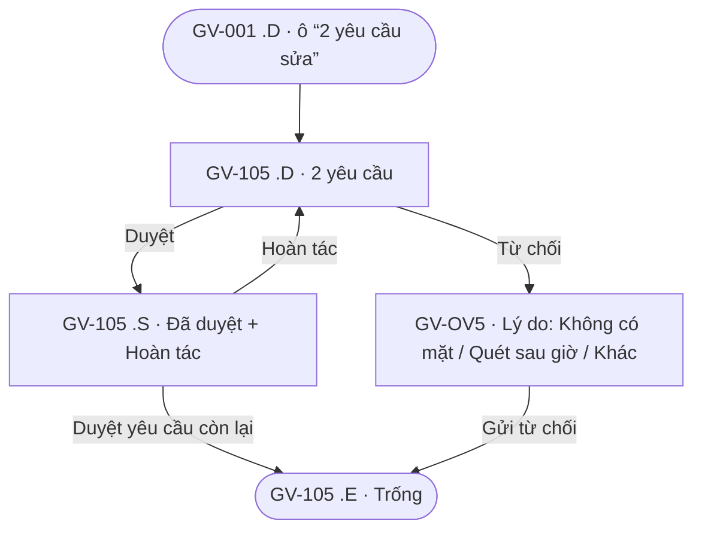

# Kiến trúc thông tin và user flow

> **Trạng thái:** v1.0 · 30/10/2026, khớp Final UI (trang 03) và Prototype (trang 06) sau lượt duyệt cuối. So với v0.4: mã màn trước khi vào app đổi từ GV-A0x sang **GV-090..094**, đăng nhập web sinh viên thành **SV-090/091**, thêm **SV-002 Chi tiết môn**; nhập lớp bằng **file Excel/CSV** (không đọc FAP); Lịch chia **Hôm nay / Tuần / Tháng**; prototype có **8 luồng**. Mọi tính năng truy về E-xx trong [ma trận bằng chứng](../research/02-evidence-matrix.md).

## 1. Hệ mã màn hình

```
<Kênh>-<Số> · <Tên> .<Trạng thái>
Kênh:       GV = app giảng viên (Android)   SV = web sinh viên (điện thoại, laptop)
Số:         09x = trước khi vào app (đăng nhập, đăng ký)   00x = tab gốc   1xx = màn con   2xx = màn cháu
            OVn = lớp phủ (hộp thoại, sheet)
Trạng thái: .D mặc định  .L đang tải  .E rỗng  .X lỗi  .S thành công  .C hộp thoại xác nhận  .W khổ laptop
            Trạng thái nghiệp vụ đánh số: .D1, .D2, .E2, .X2
```

Tên khung Figma, ảnh trong `assets/figma/` và dòng trong [screen-spec.md](../design/screen-spec.md) dùng cùng một mã. Ví dụ `GV-102 · Phiên điểm danh .X · GV-OV2 Lỗi mạng`.

## 2. Kiến trúc thông tin



Lớp phủ: GV-OV1 Xác nhận chốt và GV-OV2 Lỗi mạng (trên GV-102), GV-OV3 Nhắc sinh viên (trên GV-201), GV-OV5 Lý do từ chối (trên GV-105), hộp thoại Đăng xuất (GV-004 .C).

## 3. Danh sách màn hình

17 màn app giảng viên (đề yêu cầu ≥ 8) và 6 màn web sinh viên; 61 khung tính cả trạng thái.

| Mã | Tên | Persona | Flow | Trạng thái trên Final UI | Nguồn |
|---|---|---|---|---|---|
| GV-090 | Đăng nhập (email, Google) | P-01, P-02 | FL-0 | .D, .X sai mật khẩu | D-16, D-20 |
| GV-091 | Đăng ký | P-01, P-02 | FL-0 | .D | D-16 |
| GV-092 | Xác nhận email (mã 6 số) | P-01, P-02 | FL-0 | .D | D-16 |
| GV-093 | Bắt đầu: 3 bước | P-01, P-02 | FL-0 | .D | D-21 |
| GV-094 | Quên mật khẩu | P-01, P-02 | FL-0 | .D, .S đã gửi link | D-23 |
| GV-001 | Tổng quan | P-01, P-02 | FL-0, FL-0b, FL-1, FL-2, FL-3, FL-4b | .D, .D1 slot chưa chốt, .L, .E hôm nay không dạy, .E2 kỳ chưa có lớp, .X mất mạng | E-01, E-03, E-05, E-09 |
| GV-002 | Lịch | P-01, P-02 | FL-1, FL-2 | .D1 Hôm nay, .D2 Tuần, .D3 Tháng, .E lịch trống, .E2 chưa có lịch | E-03 |
| GV-003 | Lớp | P-01 | FL-0b, FL-3 | .D, .D2 kỳ mới (kỳ cũ chỉ xem), .E chưa có lớp | E-03 |
| GV-004 | Tài khoản | P-02 | FL-0, FL-2 | .D, .C hộp thoại Đăng xuất | E-01 |
| GV-100 | Nhập lớp từ file | P-02 | FL-0, FL-0b | .D chọn file, .D1 xem trước, .L đang nhập, .X dòng lỗi, .S xong + bật nhắc | E-12 |
| GV-101 | Chi tiết slot | P-01, P-02 | FL-1 | .D1 sắp tới, .D2 đang diễn ra, .D3 đã chốt | E-03 |
| GV-102 | Phiên điểm danh | P-01, P-02 | FL-1, FL-2 | .D1 mã đang mở, .D2 đã đóng mã · xem ngoại lệ, .L đang chốt, .X lỗi mạng (GV-OV2), .S đã chốt + Hoàn tác | E-01, E-04, E-06 |
| GV-103 | Chi tiết lớp | P-01 | FL-3 | .D tab Sinh viên, .D1 tab Buổi học | E-03, E-05 |
| GV-104 | Chú ý | P-01 | FL-3 | .D, .E trống | E-05, E-22 |
| GV-105 | Yêu cầu sửa | P-01 | FL-4b | .D, .S đã duyệt + Hoàn tác, .E trống | E-06, E-20 |
| GV-201 | Hồ sơ sinh viên | P-01 | FL-3 | .D sắp chạm, .D1 quá ngưỡng (cấm thi), .S đã nhắc | E-05 |
| GV-OV1 | Xác nhận chốt | P-01 | FL-1 | hộp thoại | heuristic 5 |
| GV-OV2 | Lỗi mạng khi chốt | P-01 | FL-1 | hộp thoại lỗi | heuristic 9 |
| GV-OV3 | Nhắc sinh viên | P-01 | FL-3 | sheet | E-05 |
| GV-OV5 | Lý do từ chối | P-01 | FL-4b | sheet | E-20 |
| SV-090 | Đăng nhập (web) | P-03 | FL-4 | .D | D-17 |
| SV-091 | Đăng ký (web) | P-03 | FL-4 | .D | D-17 |
| SV-001 | Buổi vắng của tôi | P-03 | FL-4, FL-5 | .D, .D1 sắp chạm ngưỡng, .D2 vắng thêm 1 là cấm thi, .W laptop | E-21, E-22, E-25 |
| SV-002 | Chi tiết môn | P-03 | FL-4, FL-5 | .D, .W laptop | E-20, E-25 |
| SV-101 | Quét mã | P-03 | FL-4 | .D camera, .S đã ghi nhận, .X mã hết hạn, .X2 cần quyền camera | E-20 |
| SV-102 | Gửi báo sai | P-03 | FL-4 | .D, .S đã gửi | E-20 |

Thông báo nhắc chốt (GV-OV4 ở v0.4) không còn là khung trên Final UI: đó là thông báo đẩy của hệ điều hành, bật ở GV-100 .S và GV-004, mở thẳng GV-102 .D2.

## 4. Flow (theo 8 luồng prototype, trang 06)

Link bấm thử: `https://www.figma.com/proto/1qIZVpL0Q7bD9UzT5TVBRy?node-id=<id>&starting-point-node-id=<id>`

| Luồng | Điểm bắt đầu |
|---|---|
| FL-0 · Đăng nhập, đăng ký, nhập lớp lần đầu | 185:3776 |
| FL-0b · Sang kỳ mới | 185:4089 |
| FL-1 · Điểm danh một slot | 185:4139 |
| FL-2 · Không quên chốt | 185:4440 |
| FL-3 · Chăm sóc sinh viên | 185:4944 |
| FL-4 · Sinh viên quét mã, báo sai | 185:5204 |
| FL-4b · Giảng viên duyệt báo sai | 185:5385 |
| FL-5 · Sinh viên trên laptop | 188:8975 |

### FL-0 · Đăng nhập, đăng ký, nhập lớp lần đầu (P-01, P-02)

Mục tiêu: có lớp của kỳ hiện tại để điểm danh. Kết thúc: GV-001 .D.



### FL-0b · Sang kỳ mới (P-01, P-02)

Ngày đầu kỳ mới, Tổng quan về .E2 (4 ô số để “—”, thẻ “Chưa có lịch”, nút Nhập), rồi đi tiếp GV-100 như FL-0. Kỳ cũ vẫn xem được ở tab Lớp (GV-003 .D2, chip kỳ). **Quy tắc kỳ (D-18):** tháng 1–4 Spring, 5–8 Summer, 9–12 Fall, kèm năm.

### FL-1 · Điểm danh một slot (P-01, TC-1)



### FL-2 · Không quên chốt (P-02, TC-2, TC-4)



Nhắc nhở bật ở GV-100 .S và GV-004 .D: “Trước slot · 10 phút”, “Slot chưa chốt · Khi hết giờ”.

### FL-3 · Chăm sóc sinh viên (P-01, TC-3)



### FL-4 · Sinh viên quét mã, báo sai (P-03, TC-5)



### FL-4b · Giảng viên duyệt báo sai (P-01)



### FL-5 · Sinh viên trên laptop (P-03)

`SV-001 .W` (danh sách môn kéo hết chiều ngang, gợi ý “Quét mã trên điện thoại” ở chân trang) → chạm môn → `SV-002 .W` (buổi học, nhãn Có mặt / Vắng, nút Báo sai) → quay lại. Chưa có màn Báo sai cho laptop: nút Báo sai trên web lớn chưa nối.

## 5. Bảng flow ↔ màn

| Flow | Persona | Màn | Nhánh lỗi, phục hồi |
|---|---|---|---|
| FL-0 | P-01, P-02 | GV-090..094, GV-001 .E2, GV-100, GV-001 .D | GV-090 .X, GV-100 .X |
| FL-0b | P-01, P-02 | GV-001 .E2, GV-100, GV-003 .D2 | GV-100 .X |
| FL-1 | P-01 | GV-001, GV-002, GV-101, GV-102, GV-OV1, GV-OV2 | GV-102 .X, Hoàn tác |
| FL-2 | P-02 | GV-001 .D1, GV-002 .D2, GV-102, GV-OV1, GV-004 | GV-102 .X |
| FL-3 | P-01 | GV-001, GV-104, GV-003, GV-103, GV-201, GV-OV3 | GV-104 .E |
| FL-4 | P-03 | SV-090, SV-091, SV-001, SV-002, SV-101, SV-102 | SV-101 .X, .X2 |
| FL-4b | P-01 | GV-001, GV-105, GV-OV5 | Hoàn tác, GV-105 .E |
| FL-5 | P-03 | SV-001 .W, SV-002 .W | — |

Mọi màn thuộc ít nhất một flow. Lab 3 dùng FL-1, FL-3 và FL-4 làm **3 luồng chính** (đề Lab 2 yêu cầu 3), các luồng còn lại là luồng phụ của cùng vòng đời.
